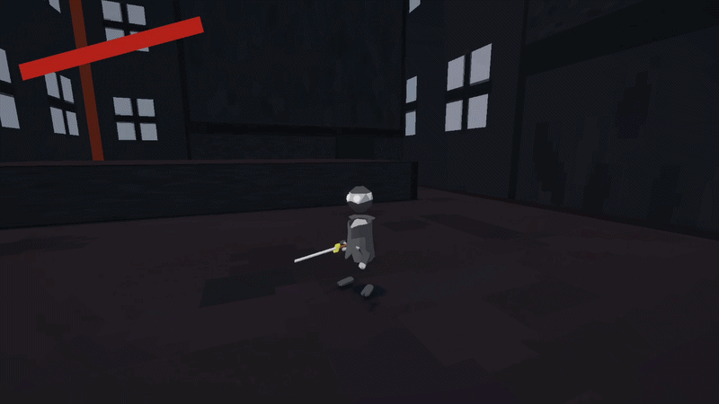
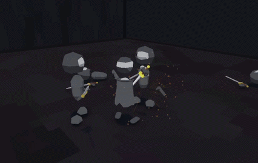
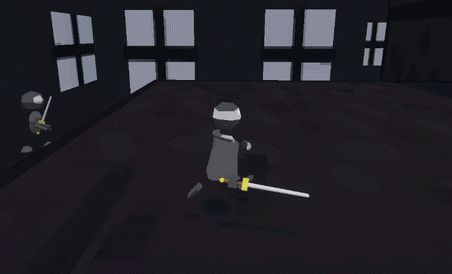
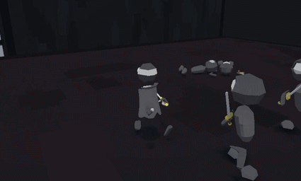

# About me
Hi! I'm Pyry Urala a Techical Designer focusing on designing and implementing gameplay mechanics for games.
I am currently studying game development in Jyväskylä Finland.
# Projects

### Project 1 - Wave Slasher
- A 3D wave based hack n slash game
- Unity
- C#
- 2026
- Solo Project
# Gameplay Mechanics
- Different combos by following a light attack with a heavy attack
  
# ___________________________________
- The player and enemies can block attacks
  
- Specific attacks will guard break the enemies and the player alike
  
  
  ### Links
- Itch.io page link
- GitHub link

#
contact
